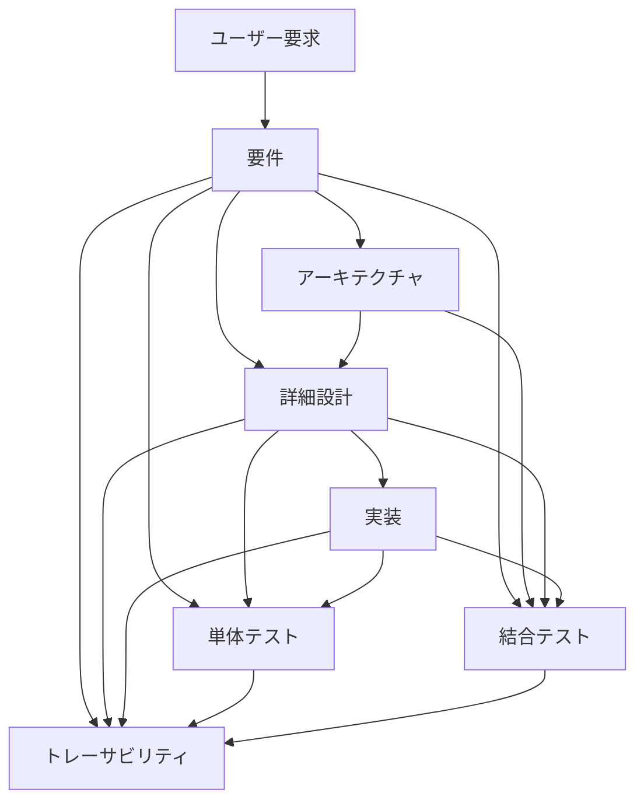

# AGENTS.md

## 1. 目的
AI駆動でWebアプリケーションを開発するためのプロジェクトルール。

対象工程:
要求整理 → 要件定義 → アーキテクチャ設計 → 詳細設計 → 製造 → 単体試験 → 結合試験 → トレーサビリティ → 運用

基本方針:
- ドキュメントはMarkdownで作成する。
- 図はMermaidで作成する。
- Clean Architecture / DDDを基本とする。
- Azure Static Web Appsへの配置を前提とする。
- 要件・設計・実装・テストの整合性を維持する。
- AIは未定義事項を推測して確定しない。
- ドキュメント、コードコメント、画面に表示する文言は日本語で作成する。
- コード識別子、API名、製品名など、技術上必要な名称は原語を使用してよい。

## 2. 成果物の正本

| 情報 | 正となる成果物 |
|---|---|
| 要件 | `docs/requirements/` |
| アーキテクチャ | `docs/architecture/` |
| 詳細設計 | `docs/design/` |
| テスト仕様 | `docs/test/` |
| 実装 | `src/` |
| テストコード | `tests/` |
| IaC | `infra/` |
| 運用 | `docs/operations/` |
| 意思決定 | `docs/architecture/decisions/` |

## 3. 成果物の流れ



基本順序は `要件 → アーキテクチャ → 設計 → 実装 → テスト → トレーサビリティ`。
ただし変更時は影響範囲を確認して上流成果物へ遡及する。

## 4. 変更時の影響範囲

要件変更時:
`要件 → アーキテクチャ → 設計 → src → tests → トレーサビリティ`

設計変更時:
- `ChangeRequests/` 内の変更要求を起点とし、その内容を変更の根拠とする。
- 次のフェーズ順に進める。
    1. 要件定義
    2. アーキテクチャ設計
    3. 機能設計
    4. 詳細設計
    5. 実装
    6. 単体試験
        - 試験項目作成
        - 試験消化
    7. 結合試験
        - 試験項目作成
        - 試験消化

- 各フェーズが完了した時点で作業を停止し、次のフェーズへ進む前にユーザーへ継続可否を確認する。
- ユーザーの継続許可を得るまでは、次のフェーズに着手しない。

実装変更時:
`src → 設計との整合性 → tests → トレーサビリティ`

実装中に仕様不足・矛盾を発見した場合、推測で確定せず確認する。

## 5. アーキテクチャ規則

基本依存方向:

```text
プレゼンテーション
    ↓
アプリケーション
    ↓
ドメイン
    ↑
インフラストラクチャ
```

ドメイン層はAzure SDK、DBドライバー、HTTPクライアント、UIフレームワーク等へ直接依存しない。
業務ロジックをUIやAPIハンドラーへ散在させない。

## 6. AI利用時の禁止事項

禁止:
- 未定義の仕様を勝手に確定すること
- 設計を無視して実装すること
- テストを通すために期待値を変更すること
- 不要なライブラリを追加すること
- 無関係なリファクタリングを行うこと
- 秘密情報をソースコードへ埋め込むこと
- 不要なAzureリソースを削除・再作成すること
- 要件・設計・テストIDを無断で変更すること

## 7. スキル

- `skills/requirements/SKILL.md`
- `skills/architecture/SKILL.md`
- `skills/design/SKILL.md`
- `skills/implementation/SKILL.md`
- `skills/unit-test/SKILL.md`
- `skills/integration-test/SKILL.md`
- `skills/documentation/SKILL.md`
- `skills/traceability/SKILL.md`

AGENTS.mdとSKILL.mdが矛盾する場合はAGENTS.mdを優先する。
