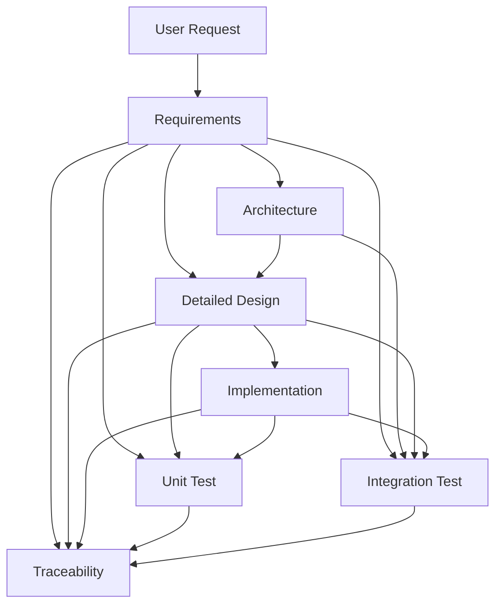

# AGENTS.md

## 1. Purpose
AI駆動でWebアプリケーションを開発するためのプロジェクトルール。

対象工程:
要求整理 → 要件定義 → アーキテクチャ設計 → 詳細設計 → 製造 → 単体試験 → 結合試験 → トレーサビリティ → 運用

基本方針:
- ドキュメントはMarkdown。
- 図はMermaid。
- Clean Architecture / DDDを基本とする。
- Azure Static Web Appsへの配置を前提とする。
- 要件・設計・実装・テストの整合性を維持する。
- AIは未定義事項を推測して確定しない。

## 2. Source of Truth

| 情報 | 正となる成果物 |
|---|---|
| 要件 | `docs/requirements/` |
| アーキテクチャ | `docs/architecture/` |
| 詳細設計 | `docs/design/` |
| テスト仕様 | `docs/test/` |
| 実装 | `src/` |
| テストコード | `tests/` |
| IaC | `infra/` |
| 運用 | `docs/operations/` |
| 意思決定 | `docs/architecture/decisions/` |

## 3. Artifact Flow



基本順序は `requirements → architecture → design → implementation → tests → traceability`。
ただし変更時は影響範囲を確認して上流成果物へ遡及する。

## 4. Change Impact

要件変更時:
`requirements → architecture → design → src → tests → traceability`

設計変更時:
`design → src → tests → traceability`

実装変更時:
`src → designとの整合性 → tests → traceability`

実装中に仕様不足・矛盾を発見した場合、推測で確定せず確認する。

## 5. Architecture Rules

基本依存方向:

```text
Presentation
    ↓
Application
    ↓
Domain
    ↑
Infrastructure
```

DomainはAzure SDK、DBドライバ、HTTPクライアント、UIフレームワーク等へ直接依存しない。
業務ロジックをUIやAPI handlerへ散在させない。

## 6. AI Guardrails

禁止:
- 未定義仕様の勝手な確定
- 設計を無視した実装
- テストを通すための期待値変更
- 不要なライブラリ追加
- 無関係なリファクタリング
- 秘密情報のソース埋め込み
- 不要なAzureリソース削除・再作成
- 要件/設計/テストIDの無断変更

## 7. Skills

- `skills/requirements/SKILL.md`
- `skills/architecture/SKILL.md`
- `skills/design/SKILL.md`
- `skills/implementation/SKILL.md`
- `skills/unit-test/SKILL.md`
- `skills/integration-test/SKILL.md`
- `skills/documentation/SKILL.md`
- `skills/traceability/SKILL.md`

AGENTS.mdとSKILL.mdが矛盾する場合はAGENTS.mdを優先する。
