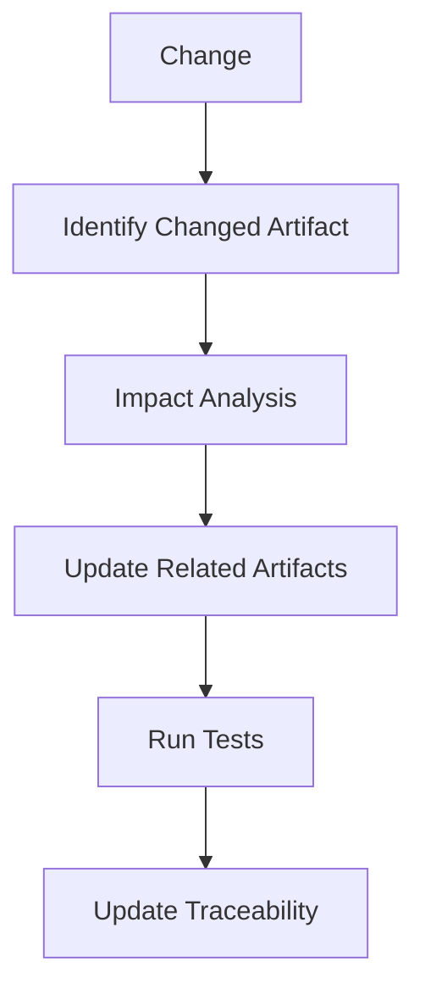

# Development Flow

## Phase 1: Requirements

Input: ユーザー要求・背景・制約  
Output: `docs/requirements/`

完了条件:
- 要件ID
- 機能要件
- 非機能要件
- ユースケース
- 受入条件
- 未確定事項

## Phase 2: Architecture

Input: `docs/requirements/`  
Output: `docs/architecture/`

完了条件:
- システム境界
- 外部システム
- レイヤー
- 依存方向
- Azure配置
- データフロー
- セキュリティ
- 必要なADR

## Phase 3: Detailed Design

Input: requirements + architecture  
Output: `docs/design/`

完了条件:
- Domain
- Application
- API
- UI
- Data
- Infrastructure
- Error/Auth/Config

## Phase 4: Implementation

Input: requirements + architecture + design  
Output: `src/`, `infra/`

## Phase 5: Unit Test

Input: requirements + design + source  
Output: `docs/test/unit/`, `tests/unit/`

## Phase 6: Integration Test

Input: requirements + architecture + design + source  
Output: `docs/test/integration/`, `tests/integration/`

## Phase 7: Traceability

Input: 全成果物  
Output: `docs/test/traceability.md`

