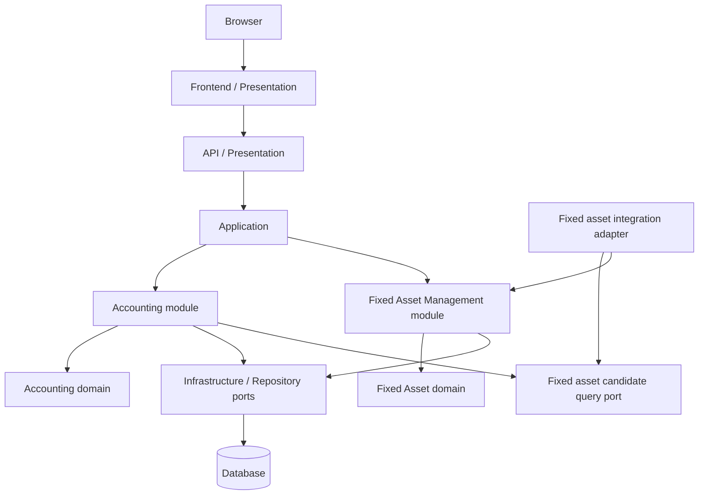

# Architecture Overview

## Principles
- Clean Architecture
- DDD
- Dependency Inversion
- Infrastructure Separation

| Layer | Responsibility |
|---|---|
| Presentation | HTTP/UI等の外部境界 |
| Application | Use Caseの調整 |
| Domain | 業務ルール・モデル |
| Infrastructure | DB・外部API・Azure SDK等 |

固定資産管理は会計機能と別の業務モジュールおよびドメイン境界として構成し、同じAPIプロセス、アプリケーション配備、環境別データベース基盤を共有する。会計コンテキストは専用ID付きの固定資産勘定（資産）と減価償却費勘定（損失）を初期勘定科目として所有し、削除を禁止する。固定資産の実体は固定資産管理コンテキストが所有し、会計側は候補照会ポートを介して資産を取得する。仕訳明細には固定資産勘定と固定資産ID参照を保持し、固定資産残高は貸借対照表の固定資産勘定に合算する。直接のテーブル共有は行わない。個別表示の切替はOPEN-DOM-015、月次償却計算や償却仕訳生成はOPEN-DOM-012/013で扱う（[ADR-004](decisions/ADR-004-fixed-asset-boundary.md)）。
