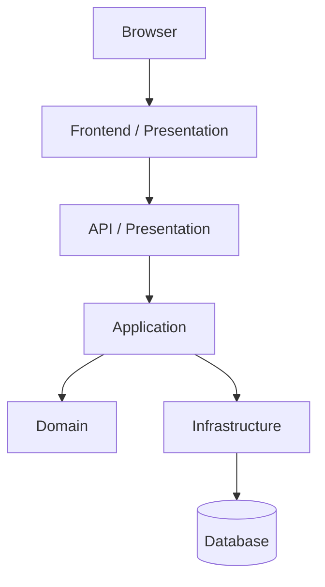

# Architecture Overview

## Principles
- Clean Architecture
- DDD
- Dependency Inversion
- Infrastructure Separation

| Layer | Responsibility |
|---|---|
| Presentation | HTTP/UI等の外部境界 |
| Application | Use Caseの調整 |
| Domain | 業務ルール・モデル |
| Infrastructure | DB・外部API・Azure SDK等 |
