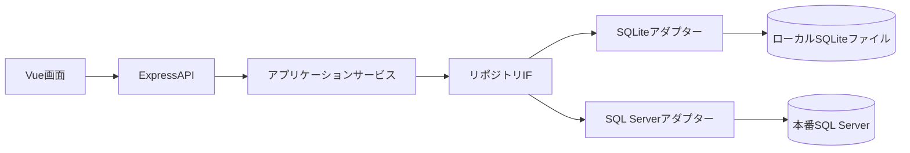

# Data Architecture

| ID | データストア | 目的 |
|---|---|---|
| DATA-001 | 会計データストア | 仕訳、仕訳明細、勘定科目、補助科目を管理し、財務諸表の集計に利用する。 |

開発ではSQLiteファイル、本番ではSQL Serverを使用する。アプリケーション層は共通リポジトリIFに依存し、接続アダプターを環境設定で選択する（[ADR-001](decisions/ADR-001-database-adapters.md)）。データ概念と関連は[ER図](../design/data/er-diagram.md)を参照する。
