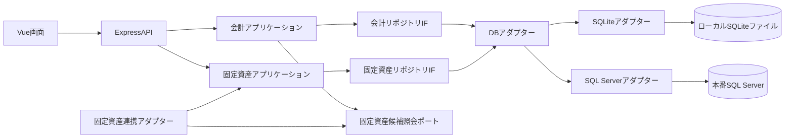

# Data Architecture

| ID | データストア | 目的 |
|---|---|---|
| DATA-001 | 会計データストア | 仕訳、仕訳明細、勘定科目、補助科目を管理し、財務諸表の集計に利用する。固定資産勘定と減価償却費勘定を専用ID付きの削除不可な初期勘定科目として保持する。 |
| DATA-002 | 固定資産データ | 固定資産と取得価格・減価償却関連設定を管理する。固定資産IDの所有権は本データにあり、仕訳候補は照会ポート経由で提供する。詳細な属性・永続化構造は詳細設計で定義する。 |

開発ではSQLiteファイル、本番ではSQL Serverを使用する。各アプリケーションモジュールは自らのリポジトリIFに依存し、DB固有処理を環境別アダプターへ分離する（[ADR-001](decisions/ADR-001-database-adapters.md)）。会計データと固定資産データは同じ環境別DB基盤を共有するが、モジュール間の直接的なテーブル参照は行わない。会計は固定資産候補照会ポートを介して固定資産IDを取得し、固定資産勘定の仕訳明細に補助科目ID相当の参照として保持する。貸借対照表では固定資産勘定残高を合算表示し、個別表示切替はOPEN-DOM-015の将来構想とする。減価償却結果の仕訳・帳票連携はOPEN-DOM-013の確定後に設計する。データ概念と関連は[ER図](../design/data/er-diagram.md)を参照する。
