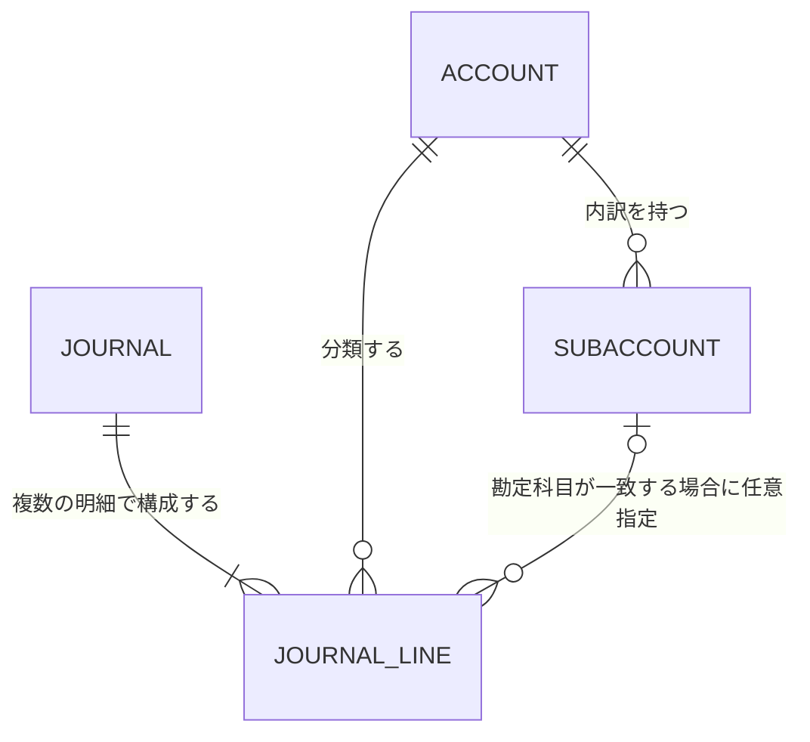

# ドメインモデル

## 境界づけられたコンテキスト

初期リリースでは、仕訳記録と財務諸表を「会計」コンテキストとして扱う。業務概念とルールは[ドメイン要件](../requirements/domain-requirements.md)を参照する。

仕訳明細は借方・貸方で共通の概念とする。各仕訳明細は勘定科目を1つ参照し、補助科目は0または1件を任意に参照できる。補助科目を指定する場合、その補助科目は同じ仕訳明細が参照する勘定科目に属する。借方・貸方の区別方法は引き続き[未確定事項](../requirements/domain-requirements.md#未確定事項)を参照する。

| ID | ルール | 関連要件 |
|---|---|---|
| DES-DOM-001 | 仕訳は複数の共通形式の仕訳明細から構成される。 | BR-002、REQ-F-001 |
| DES-DOM-002 | 仕訳明細は1つの勘定科目を参照し、勘定科目は0件以上の補助科目を持つ。 | BR-003、BR-005、REQ-F-004、REQ-F-005 |
| DES-DOM-003 | 勘定科目は資産、負債、純資産、利益、損失の区分を持つ。 | BR-004、REQ-F-004 |
| DES-DOM-004 | 仕訳明細は補助科目を0または1件参照できる。指定する場合は、その明細の勘定科目に属する補助科目に限る。 | BR-003、BR-005、REQ-F-012 |
