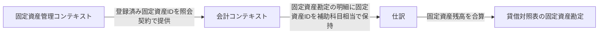
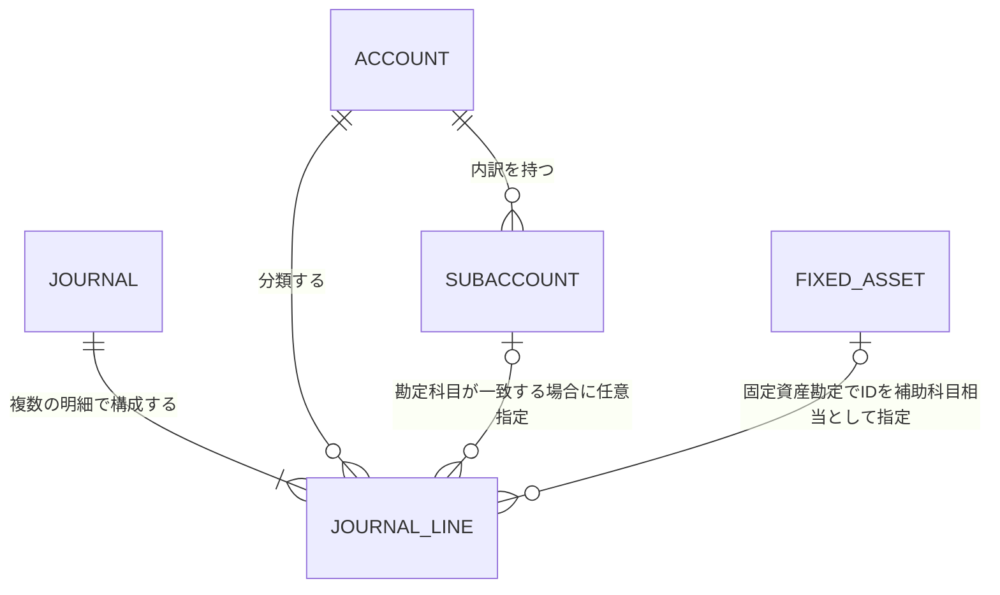

# ドメインモデル

## 境界づけられたコンテキスト

仕訳記録、勘定科目、財務諸表は「会計」コンテキストとして扱う。固定資産一覧・登録・編集・償却設定は独立したライフサイクルを持つ「固定資産管理」コンテキストに分離する。会計は固定資産勘定と減価償却費勘定を専用ID付きの初期勘定科目として所有し、いずれも削除不可とする。固定資産実体は固定資産管理が所有し、照会契約を通じて候補を提供する。会計は固定資産勘定の仕訳明細に固定資産IDを補助科目ID相当として保持する。両コンテキストは直接の永続化構造に依存しない。固定資産残高は貸借対照表で固定資産勘定に合算し、個別表示切替はOPEN-DOM-015、月次償却計算と償却仕訳生成はOPEN-DOM-012/013を参照する（[ADR-004](decisions/ADR-004-fixed-asset-boundary.md)）。業務概念とルールは[ドメイン要件](../requirements/domain-requirements.md)を参照する。

| コンテキスト | 責務 | 境界・連携 |
|---|---|---|
| 会計 | 仕訳記録、勘定科目・補助科目管理、財務諸表 | 仕訳・財務諸表と専用ID付き初期勘定科目を所有する。固定資産勘定の残高を貸借対照表に合算表示する。 |
| 固定資産管理 | 固定資産の一覧、登録・編集、取得価格および減価償却関連設定 | 固定資産の業務ルールとライフサイクル、固定資産データを所有し、会計に候補を提供する。月次償却計算・仕訳連携はOPEN-DOM-012/013の確定まで行わない。 |

仕訳明細は借方・貸方で共通の概念とする。通常の仕訳明細は勘定科目を1つ参照し、その勘定科目に属する補助科目を任意で参照する。固定資産勘定の明細では勘定科目マスタ上の固定資産勘定を参照し、固定資産IDを補助科目ID相当として任意に保持する。減価償却費勘定も勘定科目マスタ上の専用ID付き初期勘定科目とする。固定資産の実体は固定資産管理コンテキストが所有し、候補照会契約で参照する。貸借対照表では固定資産残高を固定資産勘定に合算し、個別表示切替はOPEN-DOM-015を参照する。借方・貸方の区別方法も引き続き未確定である。

| ID | ルール | 関連要件 |
|---|---|---|
| DES-DOM-001 | 仕訳は複数の共通形式の仕訳明細から構成される。 | BR-002、REQ-F-001 |
| DES-DOM-002 | 仕訳明細は1つの勘定科目を参照し、勘定科目は0件以上の補助科目を持つ。 | BR-003、BR-005、REQ-F-004、REQ-F-005 |
| DES-DOM-003 | 勘定科目は資産、負債、純資産、利益、損失の区分を持つ。 | BR-004、REQ-F-004 |
| DES-DOM-004 | 仕訳明細は補助科目を0または1件参照できる。指定する場合は、その明細の勘定科目に属する補助科目に限る。 | BR-003、BR-005、REQ-F-012 |
| DES-DOM-005 | 固定資産勘定・減価償却費勘定を専用ID付き初期勘定科目として勘定科目マスタに保持する。固定資産勘定の明細は固定資産IDを補助科目ID相当の参照として保持し、資産残高を貸借対照表で合算する。 | BR-006、REQ-F-015～017、ADR-004 |
