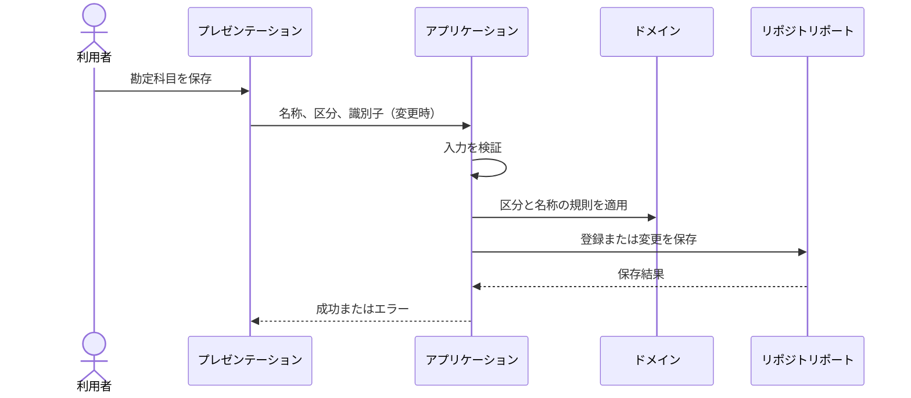

# DES-APP-002: 勘定科目・補助科目管理機能設計

## 目的

勘定科目および勘定科目に紐づく補助科目の一覧取得、登録、変更をアプリケーション層で調整する。業務ルールは[ドメイン要件](../../requirements/domain-requirements.md)、エンティティの責務は[会計ドメイン設計](../domain/DES-DOM-001-accounting.md)を正とする。

## 関連要件・成果物

- 機能要件: REQ-F-004、REQ-F-005、REQ-F-006、REQ-F-007
- ユースケース: [UC-003](../../requirements/use-cases/UC-003-account-master.md)
- 画面設計: [SCR-004](../ui/SCR-004-account-master.md)
- データ設計: [論理データ設計](../data/database-design.md)

## 処理一覧

| 処理ID | 処理 | 種別 | 説明 |
|---|---|---|---|
| APP-ACCT-001 | 勘定科目一覧取得 | Query | 区分フィルターを任意で受け取り、勘定科目名・区分・補助科目数を返す。 |
| APP-ACCT-002 | 勘定科目詳細取得 | Query | 指定された勘定科目と、その勘定科目に紐づく補助科目一覧を返す。 |
| APP-ACCT-003 | 勘定科目登録 | Command | 勘定科目名と区分を検証し、新しい勘定科目を登録する。 |
| APP-ACCT-004 | 勘定科目変更 | Command | 対象の勘定科目の存在を確認し、勘定科目名と区分を変更する。 |
| APP-ACCT-005 | 補助科目登録 | Command | 親となる勘定科目の存在を確認し、補助科目名を登録する。 |
| APP-ACCT-006 | 補助科目変更 | Command | 親勘定科目と対象補助科目の関連を確認し、補助科目名を変更する。 |

## 入出力

| 処理 | 入力 | 成功時の出力 |
|---|---|---|
| 勘定科目一覧取得 | 区分フィルター（任意） | 勘定科目識別子、名称、区分、補助科目数の一覧。識別子の形式は未確定。 |
| 勘定科目詳細取得 | 勘定科目識別子 | 勘定科目識別子、名称、区分、補助科目一覧。 |
| 勘定科目登録 | 名称、区分 | 登録された勘定科目。 |
| 勘定科目変更 | 勘定科目識別子、名称、区分 | 変更後の勘定科目。 |
| 補助科目登録 | 勘定科目識別子、補助科目名 | 登録された補助科目。 |
| 補助科目変更 | 勘定科目識別子、補助科目識別子、補助科目名 | 変更後の補助科目。 |

## 処理フロー

### 一覧・詳細取得

1. プレゼンテーション層から検索条件または勘定科目識別子を受け取る。
2. 一覧取得では任意の区分条件を使い、勘定科目と補助科目数を取得する。
3. 詳細取得では勘定科目の存在を確認し、その勘定科目に属する補助科目を取得する。
4. 画面表示用の結果を返す。データの格納方式や集計クエリは物理設計で決定する。

### 勘定科目登録・変更

1. 名称が空でなく、区分が資産・負債・純資産・利益・損失のいずれかであることを検証する。
2. 登録時は勘定科目を新規作成する。変更時は識別子に対応する勘定科目の存在を確認する。
3. ドメインモデルの勘定科目に登録または変更を委譲する。
4. 保存ポートを通じて変更を永続化し、登録・変更後の勘定科目を返す。

### 補助科目登録・変更

1. 補助科目名が空でないことを検証する。
2. 親勘定科目の存在を確認する。変更時は補助科目が当該勘定科目に属することも確認する。
3. ドメインモデルの関連付け規則に従い、補助科目を登録または変更する。
4. 保存ポートを通じて変更を永続化し、登録・変更後の補助科目を返す。

勘定科目と補助科目の保存は画面上で別操作とする。両方を同時に保存することや、複数操作をまとめたトランザクションは本設計では定義しない。

## 入力検証・業務規則

- 勘定科目名と区分は勘定科目の登録・変更に必須とする（REQ-F-006）。
- 区分は5つの定義済み区分に限定する（REQ-F-004、BR-004）。
- 補助科目名は補助科目の登録・変更に必須とする（REQ-F-007）。
- 補助科目は既存の勘定科目に紐づける（BR-005）。
- 名称の最大長・一意性、コード体系は未確定のため、重複拒否や文字数制限を本処理で仮定しない（OPEN-DOM-004）。
- 削除・無効化処理は提供しない（OPEN-DOM-003）。

## 依存ポート

| ポート | 役割 | 備考 |
|---|---|---|
| 勘定科目取得・保存 | 区分による一覧取得、識別子による取得、登録・変更を行う。 | インターフェース名、物理実装、トランザクション方式は未確定。 |
| 補助科目取得・保存 | 勘定科目単位の一覧取得、登録・変更を行う。 | 親子関係の永続化方式は未確定。 |

アプリケーション層はDB製品やドライバーに依存せず、具体的な永続化処理はインフラストラクチャ層へ委譲する。

## 結果・エラー

| 条件 | 結果 |
|---|---|
| 必須入力がない、または区分が定義外 | 入力エラーとして返し、永続化しない。 |
| 指定された勘定科目が存在しない | 対象なしとして返し、更新・補助科目登録を行わない。 |
| 指定された補助科目が対象勘定科目に属さない | 対象なしとして返し、更新しない。 |
| 永続化に失敗 | システムエラーとして返し、成功応答を返さない。具体的なエラー形式と再試行方針は未確定。 |
| 一覧・詳細の対象がない | 空の一覧、または対象なしを返す。画面表示はSCR-004に従う。 |

重複名称の扱い、同時更新時の競合、権限による拒否などは要件未確定のため、結果コードを定義しない。

## シーケンス

## 未確定事項との対応

- OPEN-DOM-003: 削除・無効化、参照中データの扱い、権限。
- OPEN-DOM-004: 識別子・コード、属性制約、名称の一意性と最大長。
- 永続化方式、物理テーブル、トランザクション境界の詳細はデータ・インフラ設計で確定する。