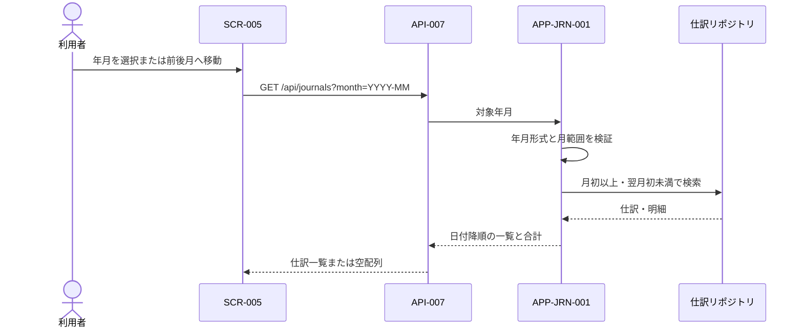

# DES-APP-003: 月別仕訳一覧機能設計

## 目的

指定年月の仕訳を検索して一覧表示用データを返す。画面の前月・翌月操作は対象年月を更新し、同じ検索処理を再実行する。

## 関連要件・成果物

- 機能要件: REQ-F-008、REQ-F-011
- ユースケース: [UC-004](../../requirements/use-cases/UC-004-journal-list.md)
- 削除ユースケース: [UC-006](../../requirements/use-cases/UC-006-journal-delete.md)
- 画面設計: [SCR-005](../ui/SCR-005-journal-list.md)
- API設計: [API-007、API-012](../api/api-design.md)
- データ設計: [論理データ設計](../data/database-design.md)

## 処理一覧

| 処理ID | 処理 | 種別 | 説明 |
|---|---|---|---|
| APP-JRN-001 | 月別仕訳一覧取得 | Query | 必須の対象年月から対象範囲を求め、その範囲の仕訳ヘッダー・明細・借方貸方合計を返す。 |
| APP-JRN-002 | 仕訳削除 | Command | 対象仕訳の存在を確認し、確認後に仕訳と明細を物理削除する。 |

## 入出力

| 項目 | 内容 |
|---|---|
| 入力 | `month`: `YYYY-MM`形式の対象年月。 |
| 出力 | 仕訳ID、取引日、摘要、明細、借方合計、貸方合計の配列。該当なしの場合は空配列。 |

## 処理フロー

1. API層から必須の`month`を受け取る。
2. 年月が `YYYY-MM` 形式で、月が01～12であることを検証する。不正な場合は入力エラーとする。
3. 対象月の初日を含み、翌月初日を含まない範囲を求める。
4. リポジトリポートへ対象範囲を渡し、仕訳と明細を取得する。
5. 各仕訳の借方合計・貸方合計を組み立て、取引日降順、同日は仕訳ID降順で返す。
6. 該当仕訳がない場合は空配列を返す。

## 依存ポート

| ポート | 役割 | 備考 |
|---|---|---|
| 仕訳一覧取得 | 開始日を含み、終了日を含まない範囲で仕訳と明細を取得する。 | SQLite/SQL Server共通のリポジトリIFを使用する。 |
| 仕訳の物理削除 | 確認確定後、仕訳と全明細を同一トランザクションで物理削除する。 | 削除確認はプレゼンテーション層で行う。 |

検索条件は `entry_date >= 月初日 AND entry_date < 翌月初日` とする。DB固有の日付関数やSQLはアダプター内に閉じ込める。

## 結果・エラー

| 条件 | 結果 |
|---|---|
| 年月が未入力・不正 | 入力エラーを返し、リポジトリを呼び出さない。 |
| 対象仕訳なし | 空配列を返す。 |
| DB取得失敗 | システムエラーとして返し、成功応答を返さない。 |

## 仕訳削除

1. 一覧行から渡された仕訳IDの形式を検証する。
2. 対象仕訳が存在することを確認する。存在しない場合は対象なしを返す。
3. リポジトリポートへ削除を依頼する。
4. 成功後、画面が対象月の一覧を再取得できるよう成功結果を返す。

削除確認後、仕訳ヘッダーと明細を同一トランザクションで物理削除する。アプリケーションから復元できない。監査証跡とバックアップ保持はOPEN-DOM-006に従う。

## シーケンス

初期表示年月は利用者の現在月とする（REQ-F-008）。