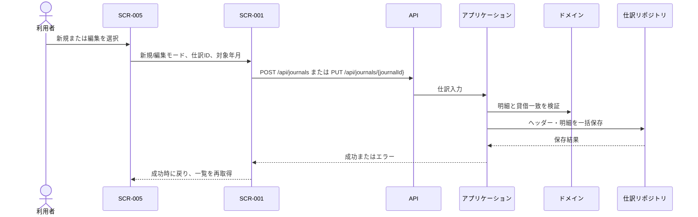

# DES-APP-004: 仕訳登録・編集機能設計

## 目的

仕訳一覧から開始された新規登録または既存仕訳の編集を調整し、借方・貸方が一致する仕訳を一括して保存する。

## 関連要件・成果物

- 機能要件: REQ-F-001、REQ-F-009、REQ-F-010
- ユースケース: [UC-001](../../requirements/use-cases/UC-001-journal-entry.md)、[UC-005](../../requirements/use-cases/UC-005-journal-edit.md)
- 画面設計: [SCR-001](../ui/SCR-001-journal-entry.md)、[SCR-005](../ui/SCR-005-journal-list.md)
- ドメイン設計: [DES-DOM-001](../domain/DES-DOM-001-accounting.md)
- データ設計: [論理データ設計](../data/database-design.md)

## 処理一覧

| 処理ID | 処理 | 種別 | 説明 |
|---|---|---|---|
| APP-JRN-003 | 仕訳登録画面用データ取得 | Query | 新規時は勘定科目などの入力候補を返す。 |
| APP-JRN-004 | 仕訳登録 | Command | 入力を検証し、仕訳ヘッダーと全明細を一括保存する。 |
| APP-JRN-005 | 仕訳編集データ取得 | Query | 対象仕訳と明細を取得し、存在しない場合は対象なしを返す。 |
| APP-JRN-006 | 仕訳変更 | Command | 対象仕訳の存在、明細、貸借一致を検証し、ヘッダーと明細を一括変更する。 |

## 入出力

| 処理 | 入力 | 成功時の出力 |
|---|---|---|
| 仕訳登録 | 取引日、摘要、借方・貸方明細 | 登録された仕訳と仕訳ID。 |
| 仕訳編集データ取得 | 仕訳ID | 取引日、摘要、明細、借方合計、貸方合計。 |
| 仕訳変更 | 仕訳ID、取引日、摘要、借方・貸方明細 | 更新された仕訳。 |

## 処理フロー

### 新規登録

1. SCR-005から遷移情報を受け取り、新規モードでフォームを表示する。
2. 日付、摘要、明細構成を検証する。
3. 全明細の勘定科目が存在し、金額が正の円整数であることを検証する。
4. 借方合計と貸方合計の一致をドメイン規則で検証する。
5. 仕訳ヘッダーと明細を同一トランザクションで保存する。
6. 成功時にSCR-005へ戻り、保存した仕訳の取引年月を表示して一覧を再取得する。

### 編集

1. SCR-005から仕訳IDを受け取り、編集モードで既存の仕訳と明細を取得する。
2. 対象が存在しない場合は対象なしエラーを表示し、一覧へ戻る手段を提示する。
3. 保存時に登録と同じ項目・金額・貸借一致検証を行う。
4. 仕訳ヘッダーと明細を同一トランザクションで更新する。旧明細と新明細の置換方法はリポジトリ実装に委譲する。
5. 成功時はSCR-005へ戻り、変更後の取引年月を表示して一覧を再取得する。
6. キャンセル時は変更を保存せず、起点の一覧へ戻る。

## 不変条件・エラー

- 登録・変更後の仕訳は借方合計と貸方合計が一致する（BR-001）。
- 明細の勘定科目が存在しない場合、ヘッダー・明細のいずれも保存しない。
- 編集対象が存在しない場合は404相当の対象なしを返す。
- 変更保存に失敗した場合はトランザクションをロールバックし、既存仕訳を保持する。
- 入力エラーは400相当として返し、画面に入力値を保持して表示する。
- 登録・編集成功後は保存後の仕訳取引年月を表示する仕訳一覧へ戻る。

## 依存ポート

仕訳の取得・登録・置換更新を行うリポジトリIFを使用する。DB固有の更新方法やSQLはSQLite/SQL Server各アダプターに閉じ込める。トランザクション境界は仕訳ヘッダーと全明細を含む。

## シーケンス

仕訳の削除はDES-APP-003で定義し、確認後にヘッダーと明細をトランザクション内で物理削除する。監査証跡とバックアップ保持のみ[OPEN-DOM-006](../../requirements/domain-requirements.md#未確定事項)で確認する。