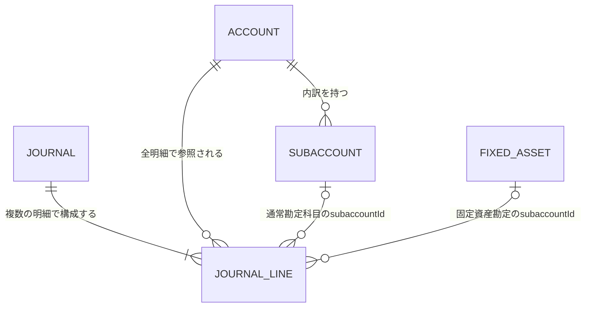

# ER図

以下はドメイン要件から導いた論理ER図であり、物理テーブルや列定義を確定するものではない。固定資産IDは固定資産勘定が選択された仕訳明細のsubaccountId欄で扱う。

仕訳明細を共通構造とし、借方・貸方ごとに別テーブルを設けない。すべての明細はACCOUNTを参照する。ACCOUNTのsystem_keyが固定資産勘定を示す場合、subaccountIdはFIXED_ASSETのIDを表し、それ以外の場合は親ACCOUNTに属するSUBACCOUNTのIDを表す。FIXED_ASSETは固定資産管理コンテキストが所有し、両関係とも論理参照でありDB外部キーを意味しない。貸借対照表では固定資産勘定残高を合算し、資産別の個別表示切替はOPEN-DOM-015を参照する。
