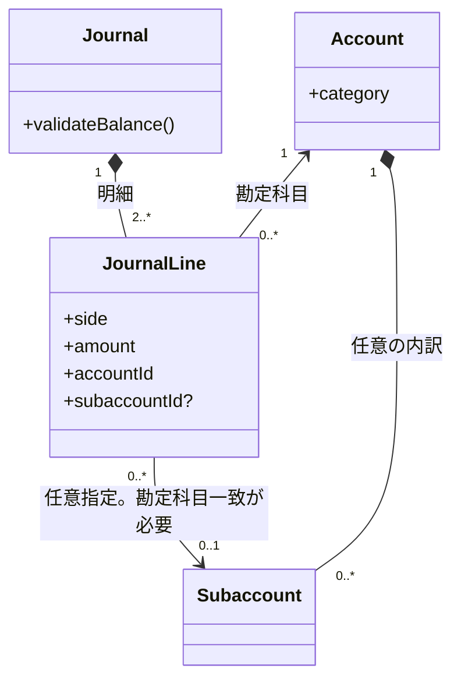

# DES-DOM-001: 会計ドメイン設計

## 責務

仕訳と仕訳明細を扱い、仕訳の貸借一致を保証する。勘定科目と補助科目を参照し、財務諸表に必要な勘定科目区分を提供する。業務上の定義は[ドメイン要件](../../requirements/domain-requirements.md)を正とする。

## ドメインモデル

## エンティティと値

| 概念 | ドメイン上の役割 | 属性・関連 |
|---|---|---|
| 仕訳（Journal） | 仕訳明細をまとめ、貸借一致を検証する集約ルート。 | 取引日・摘要は既存要件で定義済み。識別子、属性の型・必須条件は未確定。 |
| 仕訳明細（JournalLine） | 借方・貸方で共通形式を持つ仕訳の構成要素。 | 勘定科目、任意の補助科目、借貸区分、金額を扱う。補助科目を指定する場合は、同じ明細の勘定科目に属するものに限る。識別子や金額の精度・範囲は未確定。 |
| 勘定科目（Account） | 仕訳明細を分類し、財務諸表上の区分を表すマスタ。 | 区分は資産、負債、純資産、利益、損失。コード・名称等の属性は未確定。 |
| 補助科目（Subaccount） | 勘定科目の内訳を表す任意のマスタ。 | 1つの勘定科目に属する。仕訳明細から0または1件参照できる。コード・名称等の属性は未確定。 |
| 借貸区分 | 仕訳明細が借方・貸方のどちらかを示す値。 | 2区分を表す。物理表現と残高計算への規則は未確定。 |

## 集約と不変条件

- 仕訳を集約ルートとし、仕訳明細は仕訳に属する構成要素として扱う。
- 仕訳を登録する際、借方合計と貸方合計が一致しなければならない（BR-001）。
- 仕訳は複数の仕訳明細から構成され、借方・貸方は共通の明細構造を使う（BR-002）。
- 各仕訳明細は勘定科目を1つ参照する（BR-003）。
- 仕訳明細の補助科目指定は任意とし、指定する場合は当該明細の勘定科目に属する補助科目に限る（BR-003、BR-005、REQ-F-012）。
- 勘定科目は定義済みの5区分のいずれかに分類される（BR-004）。
- 補助科目は勘定科目に任意で関連付ける（BR-005）。

## 振る舞い

| 振る舞い | 説明 | 根拠 |
|---|---|---|
| 仕訳を登録する | 仕訳明細を受け取り、借方合計と貸方合計を検証する。一致しない場合は登録可能な仕訳として確定しない。 | REQ-F-001、BR-001 |
| 仕訳を変更する | 既存仕訳を変更する場合も、変更後の借方合計と貸方合計が一致することを保証する。 | REQ-F-010、BR-001 |
| 勘定科目を分類する | 勘定科目が5つの区分のいずれかを持つことを保証する。 | REQ-F-004、BR-004 |
| 補助科目を関連付ける | 勘定科目に0件以上の補助科目を関連付け、仕訳明細から任意に参照する。指定時は勘定科目との一致を検証する。 | REQ-F-005、REQ-F-012、BR-003、BR-005 |
| 仕訳を削除する | 確認後に仕訳と明細を物理削除し、通常の一覧と財務諸表から除外する。アプリケーションから復元できない。 | REQ-F-011、OPEN-DOM-006 |

## 財務諸表の計算規則

- 資産残高は借方金額から貸方金額を差し引く。
- 負債および純資産残高は貸方金額から借方金額を差し引く。
- 勘定科目区分「利益」は収益として貸方－借方、「損失」は費用として借方－貸方で集計する。
- 純資産には基準日までの利益累計から損失累計を差し引いた額を含める。
- 期間の開始日と終了日は集計対象に含める。金額は円単位の整数とする。
- 要件ID CALC-001 / CALC-002 および [ADR-002](../../architecture/decisions/ADR-002-accounting-calculations.md) を参照。

## 未確定事項

- マスタの属性とライフサイクル（OPEN-DOM-003、OPEN-DOM-004）
- 永続化の列、型、キー、制約は[論理データ設計](../data/database-design.md)で未確定としている。