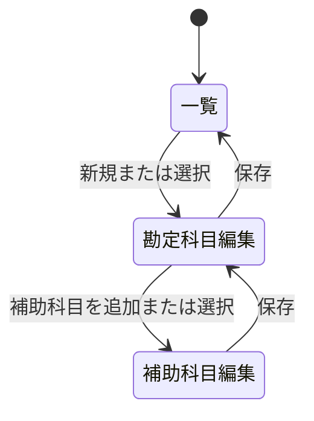

# SCR-004: 勘定科目マスタ画面設計

## 目的

勘定科目を区分ごとに確認・登録・変更し、選択した勘定科目に紐づく補助科目を登録・変更する。

## 入力・出力

| 項目 | 入出力 | 説明 | 根拠・状態 |
|---|---|---|---|
| 勘定科目区分 | 入力・表示 | 資産、負債、純資産、利益、損失から選択する。 | REQ-F-004、確定 |
| 勘定科目名 | 入力・表示 | 勘定科目の名称。コード、最大長、一意性は未確定。 | REQ-F-006、名称以外はOPEN-DOM-004 |
| 補助科目名 | 入力・表示 | 選択中の勘定科目に紐づく補助科目。その他の属性は未確定。 | REQ-F-005、REQ-F-007、OPEN-DOM-004 |
| 勘定科目一覧 | 出力 | 勘定科目名、区分、補助科目数、system key付き勘定の識別表示を行う。 | REQ-F-016 |

## 操作

- 区分を選択して勘定科目一覧を絞り込む。
- 勘定科目を選択して内容と補助科目一覧を表示する。
- 固定資産勘定と減価償却費勘定を初期勘定科目として表示する。固定資産勘定は資産、減価償却費勘定は損失区分とする。
- 勘定科目を新規登録または変更して保存する。
- 勘定科目を選択した状態で補助科目を登録または変更する。
- system key付き初期勘定科目は削除できない。専用IDと必須の区分は変更不可とする。
- その他の勘定科目の削除・無効化操作は定義しない。OPEN-DOM-003の確認後に追加する。

## バリデーション

- 勘定科目名と勘定科目区分を勘定科目の登録時に必須とする（REQ-F-004、REQ-F-006）。
- 補助科目名を補助科目の登録時に必須とする（REQ-F-007）。
- 名称の最大長と一意性は未確定（OPEN-DOM-004）。
- 勘定科目を選択するまでは補助科目を登録できない。

## 画面状態

## 関連成果物

- 要件: [REQ-F-006・REQ-F-007・REQ-F-016](../../requirements/functional-requirements.md)、[UC-003](../../requirements/use-cases/UC-003-account-master.md)
- アプリケーション機能設計: [DES-APP-002](../application/DES-APP-002-account-master.md)
- モックアップ: [勘定科目マスタ](mockups/account-master.html)