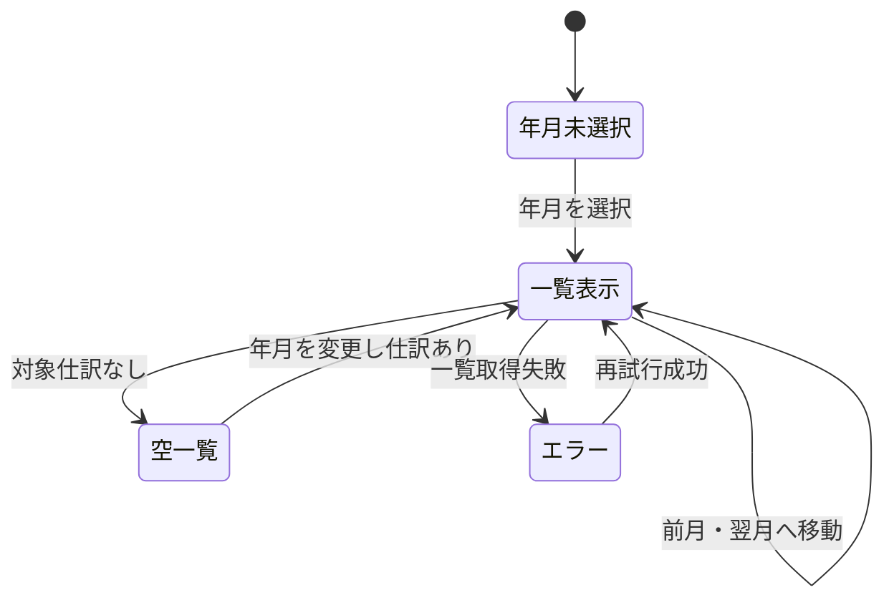

# SCR-005: 仕訳一覧画面設計

## 目的

対象年月に登録された仕訳を確認し、前月または翌月の仕訳一覧へ移動する。

## 入力・出力

| 項目 | 入出力 | 説明 | 根拠・状態 |
|---|---|---|---|
| 対象年月 | 入力・表示 | 初期値は利用者の現在月。年月選択コントロールで変更できる。形式は `YYYY-MM`。 | REQ-F-008、確定 |
| 前月・翌月 | 入力 | 対象年月を1か月変更し、変更後の一覧を再取得する。 | REQ-F-008、確定 |
| 新規登録 | 操作 | 仕訳入力画面を新規モードで開く。 | REQ-F-009、UC-001 |
| 編集・削除 | 操作 | 一覧の仕訳ごとに編集・削除ボタンを表示する。 | REQ-F-010、REQ-F-011 |
| 仕訳一覧 | 出力 | 取引日、摘要、借方合計、貸方合計、行操作を表示する。 | UC-004、DES-APP-003 |

## 操作

- 対象年月を選択すると、その年月の仕訳一覧を取得する。
- 「前月」「翌月」を選択すると、対象年月を1か月変更して一覧を再取得する。
- 年をまたぐ場合も年月を正しく繰り上げ・繰り下げる。
- 「仕訳を登録」から新規モードのSCR-001を開く。
- 行の編集ボタンから対象仕訳を指定した編集モードのSCR-001を開く。
- 登録・編集フォームを保存またはキャンセルすると一覧へ戻る。
- 登録・編集を保存した場合は保存後の取引年月へ移動して一覧を再取得する。キャンセル時は遷移元の年月を維持する。
- 行の削除ボタンの後に確認ダイアログを表示し、確定時のみ対象仕訳を物理削除して一覧を再取得する。削除後は復元できないことを示す。
- 一覧は取引日の降順とし、同日は仕訳IDの降順とする。既存APIの順序に合わせる。

## 空・エラー状態

- 対象年月に仕訳がない場合、一覧領域に「この月の仕訳はありません」と表示する。
- 年月が未選択・不正な場合は取得せず、入力エラーを表示する。
- API取得に失敗した場合はエラーを表示し、対象年月を保持したまま再試行できる。
- 削除失敗時は仕訳を一覧に残し、エラーを表示する。
- 削除をキャンセルした場合はデータを変更しない。

## 画面状態

## 関連成果物

- 要件: [REQ-F-008～REQ-F-011](../../requirements/functional-requirements.md)、[UC-004](../../requirements/use-cases/UC-004-journal-list.md)
- 登録・編集: [SCR-001](SCR-001-journal-entry.md)、[UC-001](../../requirements/use-cases/UC-001-journal-entry.md)、[UC-005](../../requirements/use-cases/UC-005-journal-edit.md)
- 削除: [UC-006](../../requirements/use-cases/UC-006-journal-delete.md)
- アプリケーション機能設計: [DES-APP-003](../application/DES-APP-003-journal-list.md)
- API設計: [API-007](../api/api-design.md)
- 画面遷移: [画面遷移図](screen-transition.md)
- モックアップ: [仕訳一覧](mockups/journal-list.html)