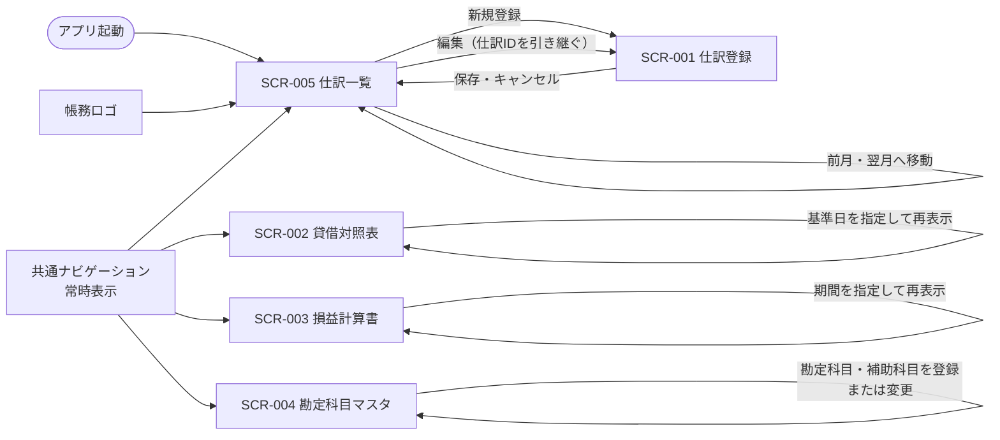

# 画面遷移図

## 対象画面

## 遷移仕様

| 起点 | 操作 | 遷移先・結果 |
|---|---|---|
| アプリ起動 | 初期表示 | SCR-005 仕訳一覧 |
| 任意の画面 | 共通ナビゲーションで画面を選択 | 選択した画面へ切り替える |
| 任意の画面 | 帳務ロゴを選択 | SCR-005 仕訳一覧へ戻る |
| SCR-005 仕訳一覧 | 新規登録を選択 | SCR-001を新規モードで開く |
| SCR-005 仕訳一覧 | 行の編集を選択 | SCR-001を対象仕訳の編集モードで開く |
| SCR-001 仕訳登録 | 保存 | 保存後の仕訳の取引年月を表示したSCR-005へ戻る |
| SCR-001 仕訳登録 | キャンセル | 遷移元の対象年月を表示したSCR-005へ戻る |
| SCR-005 仕訳一覧 | 行の削除を選択し確認で確定 | 仕訳と明細を物理削除し、同じ画面の一覧を更新する |
| SCR-005 仕訳一覧 | 年月を選択、または前月・翌月へ移動 | 同じ画面に留まり、選択月の仕訳一覧を更新する |
| SCR-002 貸借対照表 | 基準日を指定して表示 | 同じ画面に留まり、指定日時点の結果を更新する |
| SCR-003 損益計算書 | 期間を指定して表示 | 同じ画面に留まり、指定期間の結果を更新する |
| SCR-004 勘定科目マスタ | 勘定科目または補助科目を登録・変更 | 同じ画面に留まり、一覧と選択内容を更新する |

画面間の切り替えでは、保存済みデータはAPI経由で再取得する。SCR-001はSCR-005からのみ開き、新規・編集モードを持つ。保存後は仕訳取引年月へ移動し、キャンセル時は遷移元の年月を維持する。SCR-004の補助科目編集は独立画面への遷移ではなく、選択した勘定科目の画面内操作とする。仕訳削除は確認後に実行し、復元できない。