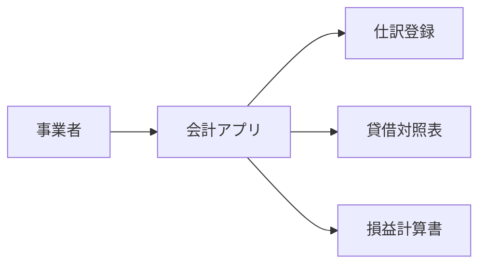

# 要件概要

## 背景
- 一般的な事業用の会計情報を管理するアプリを作成する。
- 不動産投資向けの機能は初回リリースの対象外とし、後続リリースで検討する。

## 目的
- 複式簿記に基づいて仕訳を記録できるようにする。
- 登録した仕訳から貸借対照表と損益計算書を確認できるようにする。
- 固定資産を管理し、取得価格と減価償却に関連する設定を記録できるようにする（変更要求20261012-002）。

## 対象範囲
- 初回リリース（MVP）は次の機能を対象とする。
    - 複式簿記による仕訳登録
    - 貸借対照表の表示
    - 損益計算書の表示
- MVPの画面案は `docs/design/ui/screen-list.md` に記載する。

## 対象外
- 不動産投資に特化した機能。後続リリースで検討する。
- 上記MVP機能以外の会計機能は、初回リリースに含めるか未確定。

## 追加要求
- 固定資産の一覧、新規登録、編集、取得価格および減価償却関連設定の記録（変更要求20261012-002）。初回リリースへの収録と詳細範囲はOPEN-008で確認する。

## 将来構想
- 固定資産の減価償却費を月次で自動計算する。計算方法・適用条件はOPEN-DOM-012で定義する。

## アクター
| ID | アクター | 説明 |
|---|---|---|
| ACT-001 | 事業者 | 事業の会計情報を記録し、財務諸表を確認する利用者。個人・法人の別や複数利用者の権限は未確定。 |

## システム概要

## 未確定事項
| ID | 内容 | 状態 |
|---|---|---|
| OPEN-001 | 想定する利用者（個人事業主、法人担当者など）と利用者数・権限 | 未確定 |
| OPEN-002 | 勘定科目体系、勘定科目の初期設定・追加・変更方法 | 未確定 |
| OPEN-003 | 会計期間、決算期、財務諸表の集計・表示ルール | 未確定 |
| OPEN-004 | 税務申告への利用有無、対象国・地域、税制への対応範囲 | 未確定 |
| OPEN-005 | データの登録方法、銀行・会計サービス等との外部連携 | 未確定 |
| OPEN-006 | 対応端末、認証、データ保護、保存期間などの非機能要件 | 未確定 |
| OPEN-007 | MVP外の会計機能と、不動産投資向け機能の優先順位 | 未確定 |
| OPEN-008 | 固定資産管理機能を初回リリースに含めるか、および「固定資産管理」の対象範囲 | 変更要求20261012-002により機能要求は追加。資産種別とリリース位置づけは未確定 |
